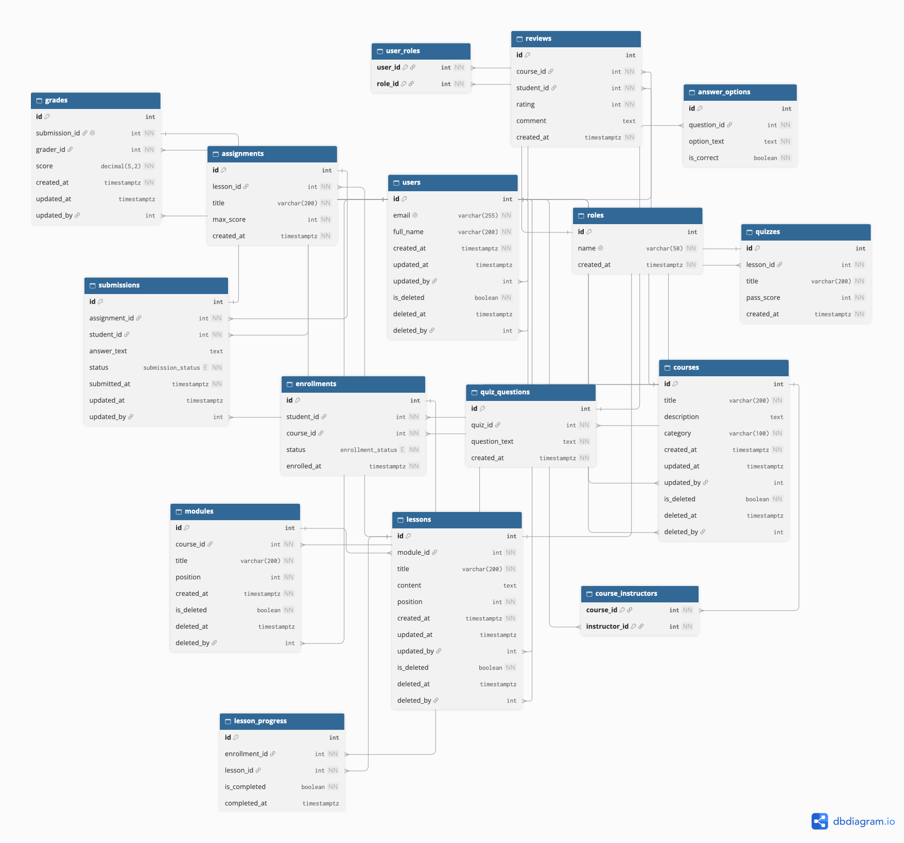

# Схема управління навчальними курсами

## 1. Схема бази даних



## 2. Короткий опис сутностей

База даних покриває повний цикл онлайн-курсів:

- **Користувачі та ролі**: `users`, `roles`, `user_roles`.
- **Курси та наповнення**: `courses`, `course_instructors`, `modules`, `lessons`.
- **Навчальний процес**: `enrollments` (записи на курс), `lesson_progress` (прогрес по уроках).
- **Завдання та оцінювання**: `assignments`, `submissions`, `grades`.
- **Тестування**: `quizzes`, `quiz_questions`, `answer_options`.
- **Зворотний зв'язок**: `reviews` (відгуки та оцінки курсів).

### Спеціальні поля:

- **Soft Delete** (`is_deleted`, `deleted_at`, `deleted_by`): у таблицях `users`, `courses`, `modules`, `lessons`. Дані не видаляються назавжди, а позначаються як видалені.
- **Дата та автор останньої зміни** (`updated_at`, `updated_by`): у таблицях `users`, `courses`, `lessons`, `submissions`, `grades`.

## 3. Об'єкти бази даних (SQL)

- **Розрізи даних (Views) — 6 шт.** (`v_active_users`, `v_active_courses`, `v_course_details`, `v_student_enrollments`, `v_submission_grades`, `v_course_ratings`).
- **Збережені процедури (Stored Procedures) — 10 шт.**: м'яке видалення та відновлення (`sp_soft_delete_user`, `sp_restore_user`, `sp_soft_delete_course`), запис на курс (`sp_enroll_student`), створення сутностей, оцінювання (`sp_grade_submission`).
- **Користувацькі функції (Functions) — 3 шт.**: підрахунок прогресу студента у відсотках (`fn_student_course_progress`), розрахунок середнього балу (`fn_student_avg_grade`), перевірка ролі (`fn_user_has_role`).
- **Тригери (Triggers) — 5 шт.**: автоматичне оновлення дати `updated_at`, фіксація часу завершення уроку, заборона видалення користувача з активними записами на курси.
- **Індекси (2 типи)**:
  - **B-tree** (часткові індекси для швидкого пошуку за email, курсами, студентами).
  - **GIN** (повнотекстовий пошук за назвами курсів та контентом уроків).

## 4. Робота з коду: Repository + Unit of Work

- **Repository** (`UserRepository`, `CourseRepository`, `EnrollmentRepository`, `SubmissionRepository`): не роблять прямих `SELECT/INSERT` до базових таблиць — усі запити йдуть виключно через збережені процедури, функції та розрізи даних (Views).
- **Unit of Work** (`UnitOfWork`): об'єднує декілька операцій в одну спільну транзакцію (`BEGIN / COMMIT / ROLLBACK`).
- **Service** (`CourseManagementService`): бізнес-логіка, яка використовує Unit of Work для атомарних дій.

## 5. Запуск проєкту

```bash
docker compose up -d
```

```bash
npm test
```

Тести перевіряють:

1. Успішну атомарну транзакцію (commit).
2. Відкат змін при виникненні помилки (rollback).
